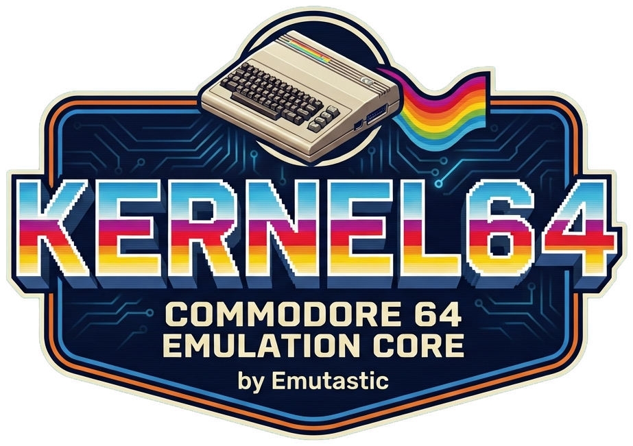

<p align="center"></p>

# Kernal64

A Commodore 64 emulator written from scratch, cycle-exact, shipped as a libretro core for
RetroArch and Emutastic, for Linux, Windows and macOS.

The whole machine is in: the 6510, both CIA generations, the VIC-II in its PAL and NTSC chip
generations, the 6581 and 8580 SIDs, cartridges (plain, bank-switched and freezers), a 1541
running its own DOS, the datasette, and a CMD HD hard drive running its own DOS.

## What sets it apart

Compared with VICE (3.9), the long-standing C64 emulator our tests are checked against:

- **`.nib` disk dumps load directly.** VICE needs them converted to `.g64` first.
- **More of the test suite passes.** Kernal64 passes the same 1,176 test programs as VICE and 16 that VICE fails,
  among them `vsp-tester`.
- **More SID test programs pass:** 157 of 165 chip-verified programs, against VICE's 143.
- **Hard drives come ready.** Kernal64 makes a CMD HD image with the drive's DOS installed and its partitions
  formatted; in VICE you install the DOS yourself from the drive's utilities disk.

In more detail:

- Every chip is built from its documents and checked against
  ground truth: the CPU against a transistor-level simulation of the 6502 and all 2,560,000
  per-opcode bus traces; the PLA against a real chip's read-out for all 65,536 inputs; the
  drives and cartridges against bytes captured from real hardware. On the established C64 test
  suite it passes 1,176 programs, as VICE does, and 16 that VICE fails.
- **Its own SID models.** The combined waveforms and the filter are our own circuit models
  of the chip, not copied tables: 157 of 165 chip-verified SID test programs pass (VICE: 143).
- **A real 1541, down to its read circuit.** The drive runs its own DOS ROM on its own 6502
  and reads a spinning disk, so fast loaders work as on the machine. `.nib` disk dumps mount
  directly, with no conversion.
- **Freezer cartridges checked against real ones.** The freeze of the type 36 cartridge
  matches, byte for byte, dumps measured on five real cartridges of both boards.
- **A real hard drive.** The CMD HD is emulated as the whole machine it is (processor, boot
  ROM, SCSI disk) and runs its own DOS from the disk. Frontends can make a ready-to-use drive in seconds:
  the drive's own programs install its DOS and format its partitions.
- **A folder as a disk.** Device 10 is a folder on your computer, on by default: save your
  programs there with no size limit, and see them as ordinary files.
- **Exact save states.** A state holds everything a replay needs, the disk's surface, the
  tape and the controllers included, so rewind, run-ahead and netplay come out the same, even
  across a SAVE to disk. The machine is built to run identically everywhere: the Linux and
  Windows builds produce the same frames, checked frame for frame.
- **Fast loading when you want it.** Tapes and disks can load at 2x or 4x with the sound
  muted, back to real speed the moment loading stops; or off, for the real thing.
- **Its own test cartridges**, which check bank-switched, flash and freezer cartridge types
  from inside the cartridge, on any emulator.

## Documentation

In the [wiki](https://github.com/codingncaffeine/Kernal64/wiki):
[system files](https://github.com/codingncaffeine/Kernal64/wiki/System-files),
[content](https://github.com/codingncaffeine/Kernal64/wiki/Content),
[drives and media](https://github.com/codingncaffeine/Kernal64/wiki/Drives-and-media),
[hard drives](https://github.com/codingncaffeine/Kernal64/wiki/Hard-drives),
[controls](https://github.com/codingncaffeine/Kernal64/wiki/Controls),
[core options](https://github.com/codingncaffeine/Kernal64/wiki/Core-options) and the
[test cartridges](https://github.com/codingncaffeine/Kernal64/wiki/Test-cartridges).

## Download

The [releases](https://github.com/codingncaffeine/Kernal64/releases) have the core for Linux
(x86-64, glibc and musl), Windows (x86-64) and macOS (arm64 and x86-64). Put it in your
frontend's cores folder; Emutastic downloads it by itself.

## System files

The machine's own ROMs are not included: put them in the frontend's system folder. They are
recognized by their contents, not their names. You need BASIC, KERNAL and the character set;
the 1541's two ROMs for disk images; and the CMD HD's boot ROM for hard drives. The full list
is on the [System files](https://github.com/codingncaffeine/Kernal64/wiki/System-files) page.

## Building

Linux, with a C++20 compiler and CMake:

```
tools/build-linux.sh
```

The core lands in `bin/kernal64_libretro.so`; `bin/kernal64` starts it in RetroArch.
`tools/release/build-cores.sh` builds the release cores for Linux and Windows in containers.

## License

GPL-3.0-or-later; see `LICENSE`.
